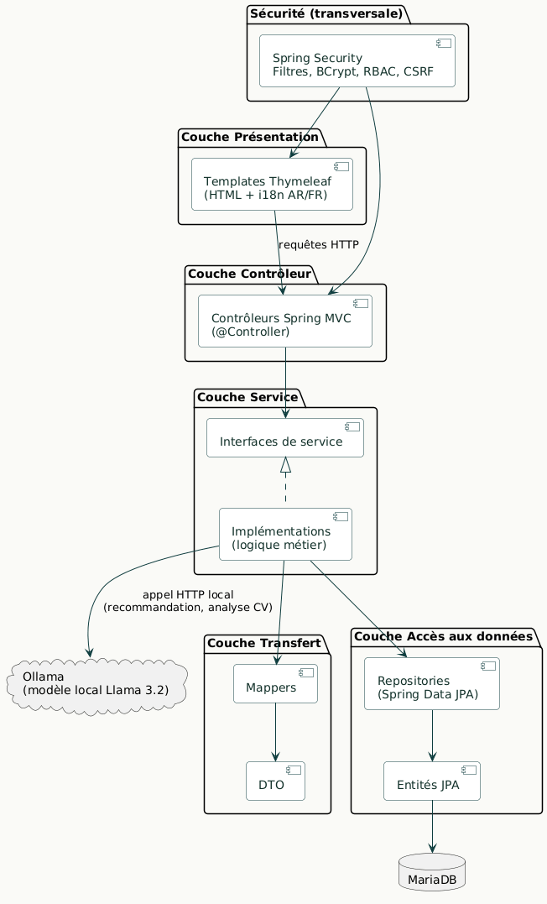

#  Plateforme de gestion de formations

> Application web **bilingue (arabe / français)** de gestion de formations, développée avec **Spring Boot**, intégrant un **assistant IA local** conçu pour protéger les données personnelles des participants.


-black)


Projet réalisé dans le cadre d'un **stage ingénieur** (ENICarthage – CNI, Unité de Formation et de Recyclage).
Il reconstruit une application PHP vulnérable en une architecture Java sécurisée et maintenable.

---

##  Fonctionnalités

**3 rôles** : Administrateur, Formateur, Participant.

- **Administrateur** : gestion des formateurs, cycles et salles ; activation des comptes ; traitement des justificatifs ; tableau de bord (graphiques) ; journal d'audit.
- **Formateur** : consultation de ses cycles, pointage de présence séance par séance (le jour même), ajout de supports de cours.
- **Participant** : inscription publique (validée par l'admin), inscription aux cycles (places = capacité de la salle, anti-chevauchement), justificatifs d'absence (sous 3 jours), attestation PDF, évaluation (1 à 5), assistant IA.

### Règles métier clés
- Attestation délivrée si le cycle est terminé et si le taux d'absences non justifiées ≤ **20 %**.
- Justificatif déposable dans les **3 jours** suivant l'absence (texte et/ou fichier).
- Statut du cycle calculé dynamiquement selon les dates.

---

##  Sécurité et confidentialité

| Mesure | Détail |
|---|---|
| Authentification | BCrypt, politique de mot de passe (8 car., maj/min/chiffre/spécial) |
| Contrôle d'accès | RBAC par rôle + vérification du propriétaire côté serveur (correction des **IDOR**) |
| Anti brute-force | 5 échecs → verrouillage 15 min |
| Limitation de débit | 15 req/min sur `/login` et `/inscription` ; 8 req/min sur les routes du chatbot (HTTP 429) |
| Sessions | Expiration 30 min, session unique par utilisateur |
| Web | CSRF, CSP, X-Frame-Options, nosniff, Referrer-Policy |
| Fichiers | pdf/jpg/jpeg/png, 5 Mo max, nom UUID, anti path-traversal, téléchargement réservé au propriétaire/admin |
| Anti-énumération | Réponse générique si l'email existe déjà |
| Audit | Journal des événements sensibles |

###  Assistant IA confidentiel
- Modèle **Llama 3.2 (3B) exécuté localement via Ollama** : aucune donnée n'est envoyée à un service externe.
- **Filtre bidirectionnel** (emails, numéros à 8 chiffres : CIN / téléphone) avant et après le modèle.
- Analyse de CV **en mémoire, sans stockage**.
- Timeout de 45 s, détection de langue (ar/fr).

**Limites assumées** : pas de défense dédiée contre l'injection de prompt ; le modèle 3B peut parfois mélanger les langues.

---

##  Architecture

Architecture en couches par module : `entity → repository → service → dto/mapper → controller → templates`.



Diagrammes UML (classes, cas d'utilisation, activités) : dossier [`docs/uml`](docs/diagrams).

---

## Technologies

Java 21 · Spring Boot 3.3.4 · Spring Security · Spring Data JPA/Hibernate · Thymeleaf · MariaDB · Lombok · OpenPDF · Chart.js · Ollama · JUnit 5 / Mockito / H2 · Maven

---

## Installation

### Prérequis
- JDK 21, Maven 3.9+
- MariaDB (ou MySQL)
- [Ollama](https://ollama.com) avec le modèle : `ollama pull llama3.2`

### Étapes
```bash
git clone https://github.com/<votre-compte>/<votre-depot>.git
cd <votre-depot>

# 1. Créer la base
mysql -u root -p -e "CREATE DATABASE bd_formation CHARACTER SET utf8mb4;"

# 2. Configurer les identifiants
cp src/main/resources/application-example.properties src/main/resources/application.properties
# puis éditer application.properties (utilisateur / mot de passe MariaDB)

# 3. Lancer Ollama (autre terminal)
ollama serve

# 4. Démarrer l'application
mvn spring-boot:run
```
Application : <http://localhost:8080>


---

## Tests
```bash
mvn test
```
Tests unitaires (services) et d'intégration (MockMvc, base H2).

---

##  Structure
```
src/main/java/.../
 ├─ config/        sécurité, i18n, filtres
 ├─ <module>/      entity, repository, service, dto, mapper, controller
src/main/resources/
 ├─ templates/     vues Thymeleaf
 ├─ messages*.properties   (ar / fr)
docs/              captures, diagrammes 
```

---

##  Perspectives
- Défense dédiée contre l'injection de prompt
- Purge automatique et suppression de compte en libre-service (droits des personnes)
- Authentification à deux facteurs
- Déploiement Docker + CI/CD

---

## Auteure
**Rahma** — Élève ingénieure, ENICarthage
[LinkedIn](https://linkedin.com/in/tobji-rahma-4b1029411) · [GitHub](https://github.com/Rahma1972)

